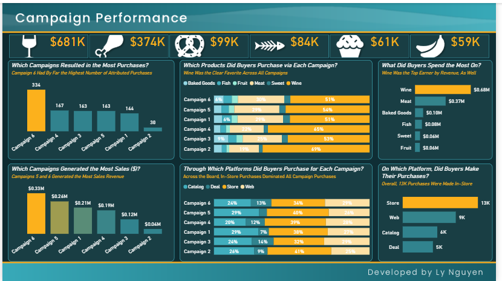
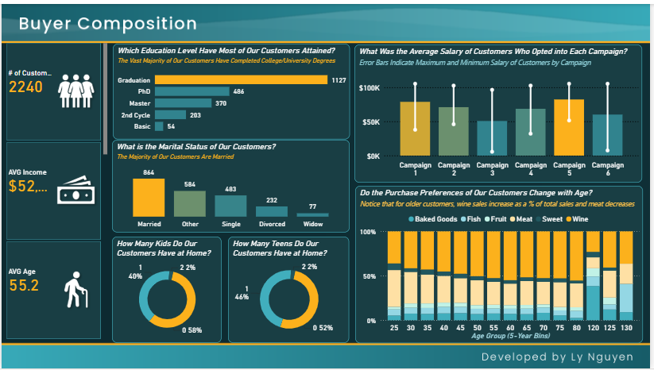
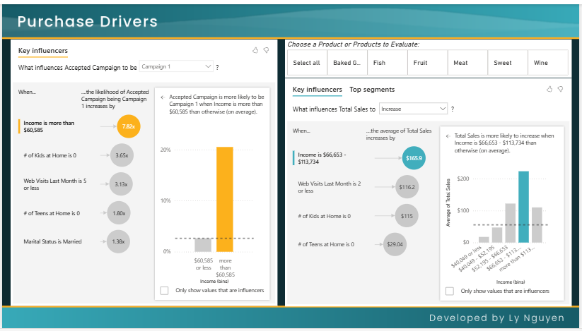

# Market Research Dashboard

A Power BI dashboard analysing customer, product and campaign data for a food and beverage retailer, built to show how its marketing campaigns perform, what customers buy, who those customers are, and what drives their purchases.

**Live dashboard:** [View on Power BI](https://app.powerbi.com/view?r=eyJrIjoiN2YzNWFjNDgtZWI2MS00MmQ4LThhN2UtZDczMjcxYTg4NTBkIiwidCI6IjQ1ZTNmMGE5LWM5NmQtNGRkOS1iOTc1LTc0MjljODBhODAyZiJ9)  
**Tools:** Power BI (Power Query, DAX, Key Influencers visual)

---

## Contents

1. [Scenario](#scenario)
2. [Dataset](#dataset)
3. [Approach](#approach)
4. [Dashboard & Insights](#dashboard--insights)
5. [Recommendations](#recommendations)

---

## Scenario

A market research firm is working with a small retail vendor that sells food and beverage products. The client is still learning about its market and customers and has shared a first sample of marketing data. The task is to build a BI tool that answers four questions:

1. How are the six most recent marketing campaigns performing?
2. How are the products performing?
3. Who are the customers?
4. What drives campaign performance and buyer decisions?

---

## Dataset

| | |
|---|---|
| **Records** | 2,240 customers |
| **Format** | CSV, plus a data dictionary (`marketmindz_research_data_dictionary.csv`) |
| **Customer enrolment** | 2012–2014 |
| **Countries** | Spain, Saudi Arabia, Canada, Australia, India, Germany, USA, Mexico |

Each row is one customer, with:
- **Demographics:** birth year, education, marital status, income, kids and teens at home, country
- **Spending (last 2 years):** wine, meat, fish, fruit, sweets, baked goods
- **Purchase channels:** store, web, catalogue and discounted (deal) purchases, plus monthly web visits
- **Campaign response:** whether the customer accepted each of six campaigns (the sixth is the most recent)

---

## Approach

1. **Clean and shape the data** in Power Query: fix types, derive age and 5-year age groups, bin income, and unpivot product spend and campaign responses so they can be compared side by side.
2. **Write DAX measures** for purchases and sales attributed to each campaign, spend by product, purchases by channel, and customer averages.
3. **Build three report pages**, one per theme, with every chart titled as a question and subtitled with its key takeaway.
4. **Use the Key Influencers visual** to identify which customer attributes are linked to campaign acceptance and higher spending.

---

## Dashboard & Insights

### 1. Campaign Performance

- **Campaign 6** is the clear winner, with **334** attributed purchases (double Campaign 4's 167) and the highest sales at **$0.33M**. **Campaign 2** performed worst on both counts (30 purchases, $0.04M).
- **Wine** is the top product overall at **$681K** in sales, almost double meat ($374K). Baked goods, fish, sweets and fruit each bring in under $100K.
- Wine also leads in every campaign, making up **51–69%** of each campaign's product mix.
- **In-store** is the main channel (**13K** purchases), followed by web (9K), catalogue (6K) and deals (5K). This pattern holds across all six campaigns.

### 2. Buyer Composition

- The typical customer is around **55 years old** with an average income of about **$52K**.
- Most are well educated: **1,127** have an undergraduate degree, and nearly 900 more hold a Master's or PhD.
- **Married** is the largest marital status group (864), followed by "Other" (584) and Single (483).
- **58%** have no children at home and **52%** have no teenagers at home.
- Customers who accepted **Campaigns 5 and 1** have the highest average salaries, while Campaign 3 attracted the lowest-income group.
- Product preferences shift with age: **wine's share of spending grows** and **meat's share shrinks** as customers get older.

### 3. Purchase Drivers

- **Income is the strongest driver** of campaign acceptance. For example, customers earning over **$60,585** are **7.8× more likely** to accept Campaign 1.
- Having **no kids at home** (3.7×) or **no teens at home** (1.8×) also raises the chance of accepting the campaign, as does low website activity.
- Total spending is highest among customers with incomes of **$66,653–$113,734**, about **$166** above average.
- Customers with no kids at home and few website visits also tend to spend more.

---

## Recommendations

- **Build on what worked in Campaign 6.** Review its offer, timing and targeting, and use it as the template for future campaigns. Retire or redesign Campaign 2's approach.
- **Lead with wine.** It is the top seller in every campaign and grows in importance with age, so wine-focused offers aimed at older customers should perform well.
- **Target higher-income households without children.** They are the most likely to respond and the biggest spenders.
- **Keep investing in stores while growing web sales.** Stores drive the most purchases, but web is a strong second channel with room to grow.
- **Collect more data** (e.g. campaign costs and dates) so future analysis can measure return on investment, not just response.

---

